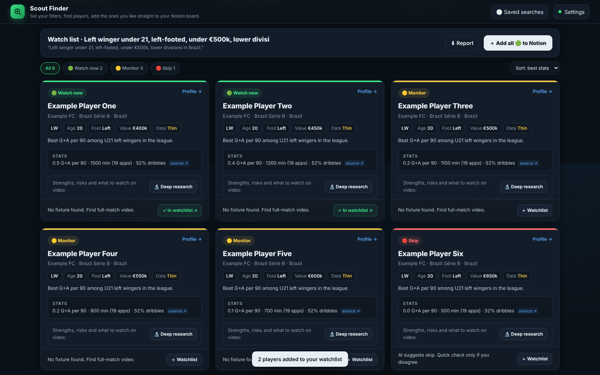
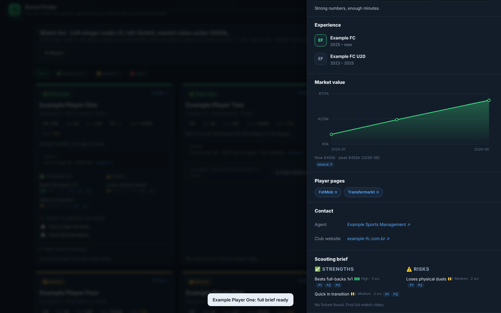

# Scout Finder

**Filters in, watch list out.** A desktop app for football scouts.

**Free to run.** By default it uses the Google Gemini free tier (no credit card) and DuckDuckGo search, with an optional free Groq key as backup. You can also run the AI fully offline with Ollama, or switch to Claude (paid) for the best briefs.

Describe the player you need in plain words ("left winger under 21, under €500k, lower divisions in Brazil") or set filters: position, age, budget, leagues, top / lower divisions, nationality, languages, foot, height, minutes, contract, stat thresholds, or your own. Scout Finder searches free football databases and ranks the players who fit **by their stats**, with one AI request for the whole list.

Click a player for a profile: details, career, a market value chart and public contacts (agent, club). Press **Deep research** on the players you like, and it reads open match reports, scouting blogs and fan forums for that player:

- **3 strengths and 3 risks**, every claim with its source links and a confidence note (how many independent sources agree; fan-only claims are always *Low*),
- **what to check on video** in the next match,
- a **signal** (🟢 Watch now · 🟡 Monitor · 🔴 Skip) with the reason, and an honest **data quality** label when information is thin.

Pick the players you want to follow and add them to a simple **Notion kanban board** with one click (optional).

> The AI prepares the list. The scout watches and decides.




## Start it (double-click)

You need **Python 3.10+**. If it is missing, the launcher opens the download page (on Windows, tick *Add python.exe to PATH* while installing).

1. **Code → Download ZIP** on GitHub, unzip, put the folder anywhere (e.g. Desktop).
2. Double-click:
   - **macOS:** `Start Scout Finder.command`. The first time, macOS may say the developer is unidentified: right-click the file → **Open** → **Open**. Only once.
   - **Windows:** `Start Scout Finder.bat`. If SmartScreen appears: **More info → Run anyway**.
3. The first start takes about a minute (it installs what it needs). Then the app opens in its own window. Keep the small terminal window open; closing it quits the app.
4. Get a free Gemini API key: go to https://aistudio.google.com/apikey, sign in with a Google account, **Create API key**. No credit card.
5. In **Settings**, paste the key. Keys are stored only on your computer, in a `Scout Finder` folder in your home directory.

Tip: make a desktop shortcut. macOS: right-click → *Make Alias*. Windows: right-click → *Send to → Desktop (create shortcut)*.

## Use it

1. Describe the player in your own words at the top ("Left winger under 21, left-footed, under €500k, lower divisions in Brazil, speaks Portuguese"). That is enough to search.
2. Optional: narrow it with the filters below, all on one screen (position, age, budget, leagues, top / + lower / only lower divisions, nationality, languages spoken, foot, height, contract, minutes, stat thresholds, style). **＋ Add filter** lets you type your own (e.g. "EU passport").
3. Pick how many players to show: top 5, 10 (default) or 15. Press **Find players**. The quick search reads the free databases and ranks the players who pass by their stats, with **one AI request** for the whole list (about 1–2 minutes).
4. Read the cards. Filter by signal, sort by age, price or data quality.
5. Click a player for the profile. Press **🔬 Deep research** there (or on the card) to read match reports, blogs and forums for that one player: strengths, risks, what to watch on video, career and contacts. One AI request per player, only when you ask. The profile shows: details, career (clubs and years), a market value chart when a source lists the history, player pages (Transfermarkt, FotMob, Sofascore) and public contacts (agent, club website, email, phone). Contacts are shown only when a public page lists them, never guessed.
6. **＋ Watchlist** sends that player to Notion; **Add all 🟢** sends every *Watch now* player. **Report** downloads the list as Markdown.
7. Every search is saved. Open old ones from **Saved searches**.



## Notion watchlist (optional)

1. In Notion, create a page with a database called **Watchlist**. Suggested properties: `Status` (status: To watch, Watching, Shortlist, Passed), `Signal`, `Position`, `Club`, `League`, `Nationality`, `Date of birth`, `Foot`, `Market value (€)`, `Data`, `Next match`, `Stats`, `Profile`, `My notes`. Add a **Board** view grouped by `Status`.
   The app only writes properties that exist, so you can keep it smaller.
2. https://www.notion.so/profile/integrations → **New integration** (Internal) → copy the secret.
3. On your Watchlist page: `•••` → **Connections** → add the integration.
4. Paste the secret into **Settings → Notion token**.

New players land in **To watch** with the full AI brief inside the card. If a player is already on the board, the card is refreshed but never moved.

## Command line (optional)

```bash
pip install -r requirements.txt
export GEMINI_API_KEY=...               # NOTION_TOKEN too if you use --notion
python scout_finder.py --position LW,RW --age-max 21 --foot Left --max-value 500000 \
  --leagues "Brazil Série B, Ghana" --min-minutes 900 \
  --criteria "G+A per 90 >= 0.4; dribble success >= 50%" --must-haves "pace in transition"
python scout_finder.py --from-json watchlist.json --notion   # add a saved list to Notion
# other providers: --provider ollama   or   --provider claude (needs ANTHROPIC_API_KEY)
```

## AI providers

| Provider | Cost | Setup | Notes |
|---|---|---|---|
| **Google Gemini** (default) | Free tier | Free key from aistudio.google.com/apikey | Picks a Flash-Lite model automatically. Each free model has its own daily limit, so when one runs out the app moves to the next (Flash-Lite → Flash → Gemma). It also spaces requests out to stay under the per-minute limit. A quick search is one request, so you can do many searches a day. **On the free tier Google may use your prompts and answers to improve its products, and human reviewers may read them.** Don't put private information in the filters. |
| **Groq** (free backup) | Free tier | Free key from console.groq.com/keys | Add it next to the Gemini key. When Gemini's free limit runs out, the app switches to Groq automatically. Shorter source text per request. |
| **Ollama** | Free, offline | Install ollama.com, then `ollama pull qwen3:8b` | Runs on your computer, nothing leaves it except the web searches. Slower, needs about 16 GB RAM. Smaller models make more mistakes. |
| **Claude** | Paid (Anthropic API) | console.anthropic.com key | Reads more sources with its own web search, best briefs. Roughly $1–3 for a 5-player search. |

Free limits change. Check Google's current numbers at https://ai.google.dev/gemini-api/docs/rate-limits.

## How it works

- `scout_finder.py` does the work.
  - **Free providers (Gemini, Ollama):** the app searches DuckDuckGo, downloads the pages and gives their text to the model with numbered sources. The model may only use those sources. Afterwards the app removes any link the model did not actually read and lowers the confidence of claims that are left with fewer sources. Answers are checked against a strict schema (Pydantic) and retried once if they don't fit.
  - **Claude:** Claude uses server-side **web search** and **web fetch** to find candidates and read sources, then a second step turns the notes into the same schema. That step may not add facts that are not in the notes.
- `app.py` starts a small local server and opens `ui.html` in a Chrome/Edge app window (or your browser). Nothing is hosted online.

## Honest limits

- It is a **watch-list tool, not a decision tool**. Stats and opinions decide what to watch, never who to sign.
- Fan forums are noisy and biased. That is why each claim shows how many independent sources back it.
- Lower leagues have little public data. The app says what is missing instead of guessing.
- The model can misread a source. Every claim links to its source so you can check.
- Free models are weaker than paid ones, and DuckDuckGo can rate-limit many searches in a row. If a search returns nothing, wait a minute and try again.
- Some sites (e.g. Transfermarkt) sometimes block automatic page reading. The app then uses the search snippet and says the data is thin.
